<h1 data-importer="text" align="center">Hi 👋, I'm Fariz Eka Kurniawan 👩‍💻 About Me Graduated in Information Technology from Brawijaya University with a strong interest in programming and knowledge in web development and database management. I have developed skills in various programming languages and frameworks including Laravel, PHP, Node.js, Database Management, and Cloud Infrastructure. I am also an alumni of Bangkit Academy 2024, taking the Cloud Computing learning path.</h1>

###

  
  
  
  
  
  
  
  
  
  
  
  
  
  
  
  
  
  
  
  
  
  
  
  
  
  
  
  
  
  
  
  
  
  
  
  
  
  
  
  
  

###

  
  
  
  
  

###

  

###

<picture data-importer="pacman">
  <source media="(prefers-color-scheme: dark)" srcset="https://raw.githubusercontent.com/FarisEka/FarisEka/pacman-output/pacman-contribution-graph-dark.svg?game=pacman">
  <source media="(prefers-color-scheme: light)" srcset="https://raw.githubusercontent.com/FarisEka/FarisEka/pacman-output/pacman-contribution-graph.svg?game=pacman">
  
</picture>

###
